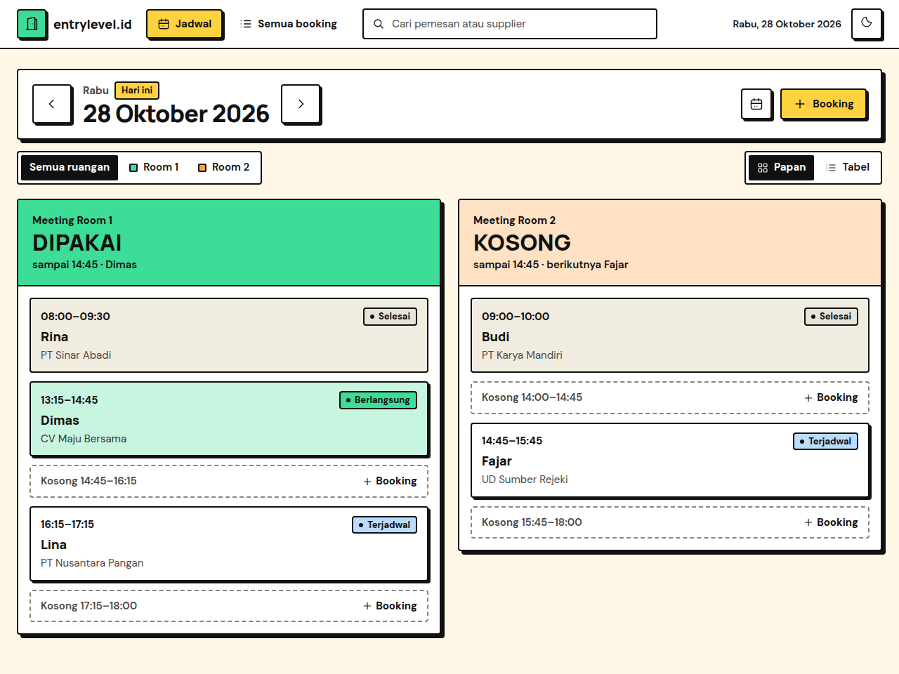

# Meeting Room Booking

Aplikasi Flask untuk mencatat booking dua ruang meeting kantor. Jadwalnya tampil sebagai papan per ruangan yang menunjukkan apakah ruangan sedang dipakai, dan jam kosongnya bisa langsung diklik untuk booking. Booking yang bentrok di ruangan yang sama ditolak.

Data disimpan di SQLite, dan semua jam memakai WIB (Asia/Jakarta). Tampilan dan pesan aplikasinya berbahasa Indonesia.



Aplikasi ini tidak punya login. Siapa pun yang bisa membuka halamannya bisa menambah, mengubah, dan membatalkan booking, jadi pasang hanya di jaringan internal.

## Kebutuhan

Python 3.11 atau lebih baru. Versi minimal ini datang dari SQLAlchemy, yang ikut terpasang bersama Flask-SQLAlchemy. Aplikasi ini dikembangkan dan diuji dengan Python 3.14.

## Mencoba di komputer sendiri

Linux atau macOS:

```sh
git clone https://github.com/entrylevelid/meeting-room-booking.git
cd meeting-room-booking
python3 -m venv .venv
.venv/bin/python -m pip install -r requirements.txt
.venv/bin/python app.py
```

Windows:

```bat
git clone https://github.com/entrylevelid/meeting-room-booking.git
cd meeting-room-booking
python -m venv .venv
.venv\Scripts\python -m pip install -r requirements.txt
.venv\Scripts\python app.py
```

Lalu buka http://127.0.0.1:5000. Ini server pengembangan bawaan Flask dan hanya bisa dibuka dari komputer itu sendiri. Database dibuat otomatis di `instance/meeting_room.db` saat aplikasi pertama kali jalan.

## Menjalankan di server

Untuk dipakai sehari-hari, jalankan dengan Gunicorn di server Linux. Gunicorn sudah ikut terpasang dari `requirements.txt`, kecuali di Windows.

```sh
.venv/bin/gunicorn --bind 0.0.0.0:8000 --workers 1 app:app
```

Pakai satu worker saja. Pengecekan bentrok jadwal mengandalkan permintaan yang diproses satu per satu, dan SQLite memang tidak cocok untuk banyak proses yang menulis bersamaan.

Supaya aplikasi jalan terus dan hidup lagi setelah server reboot, pasang sebagai service systemd. Contoh `/etc/systemd/system/meeting-room-booking.service`, dengan path dan user disesuaikan:

```ini
[Unit]
Description=Booking ruang meeting
After=network-online.target
Wants=network-online.target

[Service]
User=namauser
WorkingDirectory=/path/ke/meeting-room-booking
EnvironmentFile=/path/ke/meeting-room-booking/.env
ExecStart=/path/ke/meeting-room-booking/.venv/bin/gunicorn --bind 0.0.0.0:8000 --workers 1 app:app
ExecReload=/bin/kill -HUP $MAINPID
Restart=always
RestartSec=5

[Install]
WantedBy=multi-user.target
```

File `.env` berisi `SECRET_KEY` (lihat di bawah). Setelah itu jalankan `sudo systemctl daemon-reload` dan `sudo systemctl enable --now meeting-room-booking`. Gunicorn tidak membaca ulang template atau kode yang berubah, jadi jalankan `sudo systemctl reload meeting-room-booking` setiap kali ada pembaruan.

## Konfigurasi

Variabel lingkungan:

- `SECRET_KEY`: kunci untuk menandatangani cookie sesi. Isi dengan nilai acak yang tetap, misalnya hasil `python3 -c "import secrets; print(secrets.token_hex(32))"`. Kalau kosong, aplikasi memakai nilai bawaan yang tertulis di kode.
- `DATABASE_URL`: alamat database SQLAlchemy. Default-nya `sqlite:///meeting_room.db`, yang tersimpan di `instance/meeting_room.db`.
- `FLASK_DEBUG=1`: menyalakan mode debug saat menjalankan `python app.py`. Pakai hanya untuk pengembangan.

Nama ruangan dan zona waktu diatur di bagian atas `app.py`:

```python
ROOMS = ('Room 1', 'Room 2')
TIMEZONE = ZoneInfo('Asia/Jakarta')
TIMEZONE_LABEL = 'WIB'
```

Mengganti nama ruangan cukup di `ROOMS`. Booking lama tetap tersimpan dengan nama ruangan lama, jadi ganti nama sebelum ada data, atau ubah juga kolom `room` di database. Tampilan menyiapkan warna untuk dua ruangan (`.room-1` dan `.room-2` di `static/css/app.css`). Kalau menambah ruangan ketiga, tambahkan juga `.room-3` dengan warnanya sendiri.

## Cara pakai

Halaman Jadwal membuka tanggal hari ini sebagai papan dengan satu kolom per ruangan. Bagian atas tiap kolom menunjukkan apakah ruangan sedang dipakai dan sampai jam berapa. Di bawahnya ada booking hari itu, diselingi jam kosong. Klik jam kosong untuk membuka form dengan ruangan dan jam yang sudah terisi, atau klik booking untuk melihat detail, mengubah, atau membatalkannya. Pindah hari dengan tombol panah atau pemilih tanggal. Tombol Tabel menampilkan booking hari itu sebagai tabel.

Halaman Semua booking berisi booking dari semua tanggal, 20 per halaman, dengan filter per ruangan. Kolom pencarian di bagian atas setiap halaman mencari nama pemesan atau supplier di semua tanggal.

Booking yang bersambung (misalnya 09:00–10:00 lalu 10:00–11:00) boleh. Booking yang jamnya bertabrakan di ruangan yang sama ditolak, dan pesan errornya menyebut siapa yang sudah memakai ruangan itu. Jam selesai harus setelah jam mulai di hari yang sama.

Halaman jadwal dimuat ulang sendiri setelah 3 menit tanpa aktivitas, supaya status ruangan dan booking dari komputer lain tetap terbaru.

## Tes

```sh
.venv/bin/python -m unittest discover -s tests -v
```

Tes memakai database sementara, jadi data di `instance/meeting_room.db` tidak tersentuh. Kalau Node.js terpasang, sintaks JavaScript bisa dicek dengan `node --check static/js/app.js`.

## Lisensi

Kode aplikasi memakai lisensi MIT (lihat `LICENSE`). Font DM Sans dan Manrope di `static/fonts` memakai SIL Open Font License; lisensinya ada di folder yang sama.
